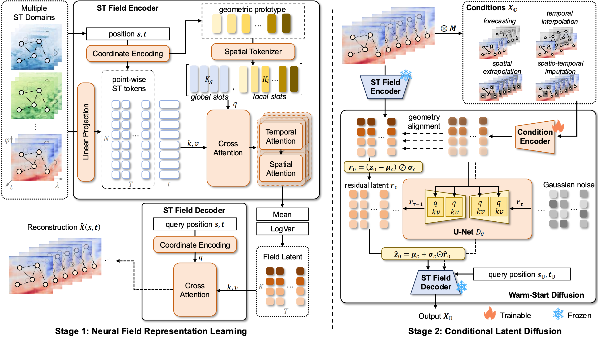

# FieldDiff

This is the official release code of the paper: 'Latent Neural Field Diffusion for Spatio-Temporal Foundation Models'.

# Abstract
Spatio-temporal foundation models (STFMs) seek to learn transferable patterns from heterogeneous data for reuse across domains. Unlike time-series foundation models, however, STFMs must additionally handle the spatial dimension, where real-world observations exhibit diverse spatial structures, resolutions, and scales. We formulate spatio-temporal foundation modeling from a field perspective, treating discrete observations as samples from continuous fields and enabling prediction at arbitrary spatio-temporal coordinates. This formulation introduces two key challenges: learning a shared field representation across heterogeneous spatial geometries and modeling the uncertainty of diverse tasks under partial observations. We propose FieldDiff, a two-stage latent neural field diffusion framework. FieldDiff learns a unified latent field by jointly encoding observed values and physical coordinates with globally shared and geometry-adaptive tokens, together with variational regularization. It further unifies forecasting, temporal interpolation, spatial extrapolation, and spatio-temporal imputation as conditional field generation, using residual latent diffusion to model uncertainty unresolved by the observations. Experiments across diverse spatio-temporal datasets demonstrate strong multi-task performance and robust zero-shot and few-shot generalization across domains and spatial scales.

